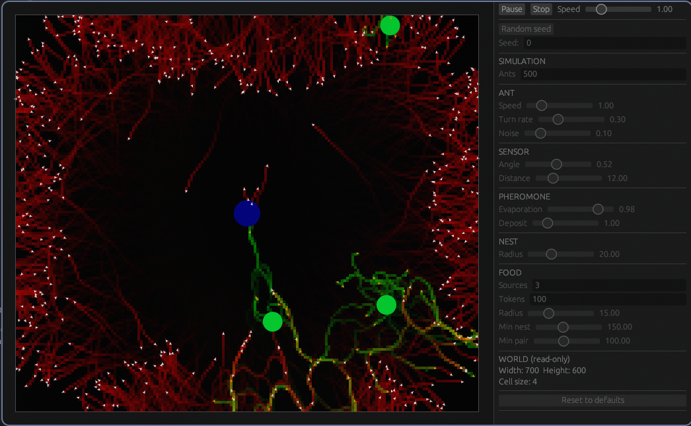

# formica-aco

*Ant-colony foraging sandbox. Rust · egui · stigmergy.*



## Preface

This repository is a learning project, kept public to show how it was built rather than what it does.  
It is a small Rust simulation of ants that find food and form trails with no leader and no map, through marks left in a shared environment (stigmergy).  
The interest lies in its construction and composition: module layout, a fixed-timestep loop decoupled from rendering, a backend migration from macroquad to eframe, and the tooling work that remains. Running it is secondary.

---

## Part 1. Evolution and next steps

### Evolution

The project started in April 2026 and was developed intermittently. The most notable change was the move from macroquad to eframe/egui in August 2026.
The history before this repository is not republished and will be kept private.  
Here is an overview of the iterative development:  

1. **Core loop.** Walking skeleton, three-sample pheromone sensor, two-channel deposit, foraging/returning state machine. Concern: correctness of the minimal model.
2. **Obstacles and interaction.** General obstacle reflection, an application lifecycle (configuring, running, paused), an egui control panel, a speed parameter and a seed control.
3. **Rendering restructure.** Drawing code split into modules, pure functions, and isolation of the macroquad-dependent code to prepare a library swap.
4. **Architecture and migration.** Reorganisation into `ants`, `world_sim` and `app`, then the macroquad → eframe migration, followed by a formatting configuration and a refactor of world generation.
5. **Publication.** Clippy warnings brought to zero, crate renamed `formica-aco`, README rewritten to match the code.

### AI-assisted development

Claude Code was used in April 2026; the produced code was then read and largely reworked by hand. Delegating code generation proved ineffective for learning purposes, so I now use Claude as a conversational assistant and limit direct code production to a minimum.
This matches an Anthropic study in which developers learning a new Python library scored 17% lower on a comprehension quiz when they used AI assistance, except when they used it for explanations rather than delegation ([blog post](https://www.anthropic.com/research/AI-assistance-coding-skills), [paper](https://arxiv.org/abs/2601.20245)).

### Next steps

The simulation code is considered complete. What remains is the surrounding engineering, independent of any new feature:

- **Tests:** unit tests for the pheromone grid, the reflection routine and the state transitions (the fixed seed makes them deterministic).
- **CI:** GitHub Actions running `cargo fmt --check`, `cargo clippy --all-targets -- -D warnings`, `cargo test --locked`, `cargo build --release --locked`.
- **Error handling:** replace the `panic!` on failed food placement and the `unwrap` in world creation.
- **Configuration and cleanup:** reconnect the unused TOML loader, remove commented-out code, document public items.

---

## Part 2. The project

### Description

500 ants (by default) start at a nest in a 700 × 600 world. Each ant is `Foraging` or `Returning` and, every tick, samples the pheromone field at three points ahead of it (straight, and at ± `sensor_angle`), then turns toward the strongest sample. A foraging ant deposits on the `Home` channel and reads `Food`; a returning ant does the reverse. Both channels are flat `Vec<f32>` grids of 4-unit cells that evaporate by a constant factor each tick, with no diffusion. Touching an active food source starts the return trip, and reaching the nest restarts foraging. Obstacles are axis-aligned rectangles with reflection; only the four boundary walls are instantiated today.

The logical tick is fixed at 1/60 s and decoupled from rendering through an accumulator, with a speed multiplier up to 5× and at most 8 ticks per frame. Runs are reproducible from a seed. This is a grid-based, two-channel foraging model.

### Structure

```text
src/main.rs                 entry point, window setup
src/lib.rs                  module tree
src/ants/                   colony (agents, FSM, per-tick motion), config, nest, pheromone grid
src/world_sim/              world, obstacles, food sources, world config
src/app/                    egui application, control panel, drawing
```

### Cargo

| Item | Value |
| --- | --- |
| Package | `formica-aco` (edition 2021, `publish = false`) |
| Toolchain | stable, with `clippy`, `rustfmt`, `rust-src` (`rust-toolchain.toml`) |
| `eframe` 0.29 | window, UI and rendering |
| `rand` 0.8 | seeded `StdRng` |
| `serde` + `toml` | configuration structs and loader (loader currently unwired) |
| `anyhow` | error handling |

`Cargo.lock` is committed: this is a binary, and a locked build is reproducible.

### Commands

```bash
git clone https://github.com/maxence-dec/formica-aco
cd formica-aco
cargo run --release                           # needs a desktop session with OpenGL
cargo fmt --check
cargo clippy --all-targets -- -D warnings
cargo test --locked
cargo build --release --locked
```

### Parameters

Most are adjustable in the side panel before a run; world size and cell size are read-only.
Default values come from early runs and have not been tuned since.

| Parameter | Default | Role |
| --- | --- | --- |
| `number` | 500 | ants |
| `speed` | 1.0 | distance per tick |
| `turn_rate` | 0.3 | steering step (rad) |
| `noise_angle` | 0.1 | random heading noise (rad) |
| `sensor_angle` | 0.524 | angle of the side sensors (rad) |
| `sensor_distance` | 12 | sensor reach |
| `evaporation_factor` | 0.98 | per-tick pheromone decay |
| `deposit_amount` | 1.0 | pheromone laid per tick |
| `nest_radius` / `food_radius` | 20 / 15 | contact zones |
| `food_source_count` / `food_tokens_per_source` | 3 / 100 | food sources |
| `min_food_distance_from_nest` / `min_food_pairwise_distance` | 150 / 100 | placement constraints |
| `inbound_interactable_sensing` | false | keep sensing inside nest and food zones |
| `sim_width` × `sim_height`, `cell_size`, `rng_seed` | 700 × 600, 4, 0 | world |
